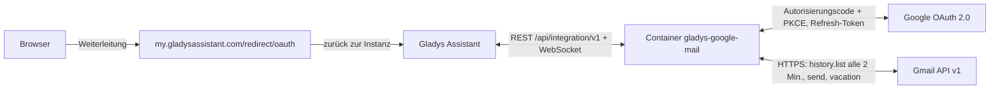
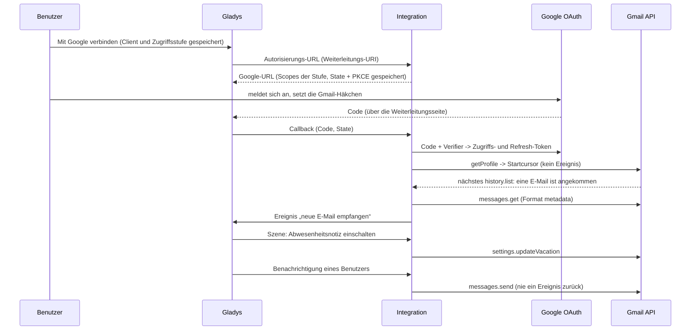
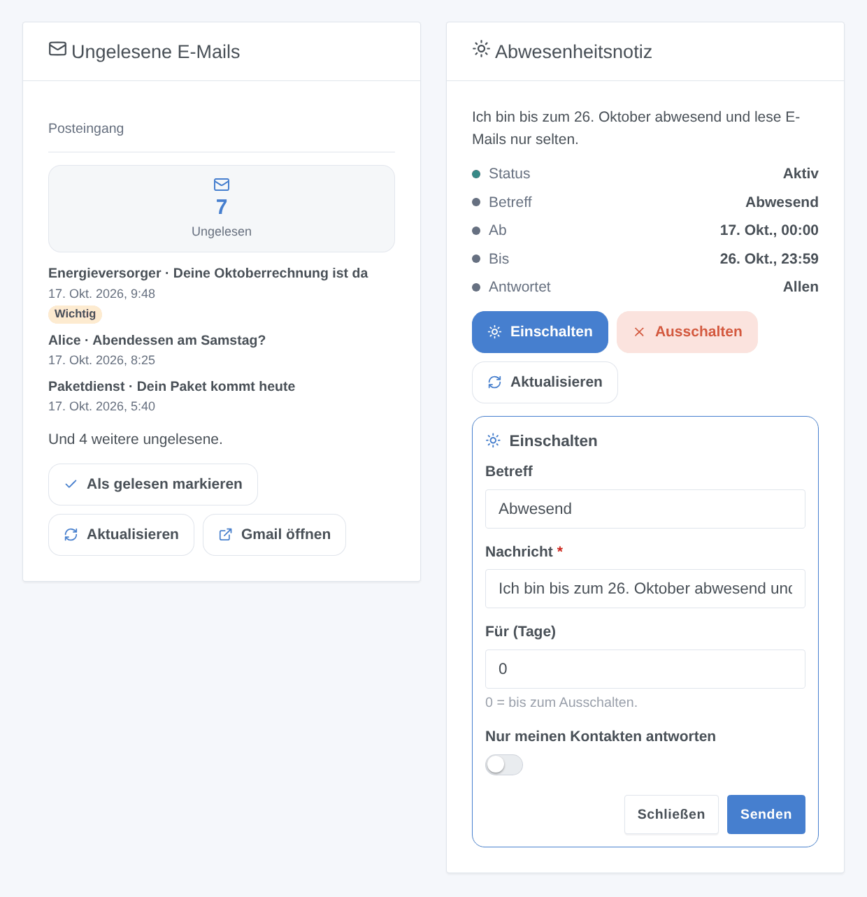

# Gladys Google Mail

[English](README.md) · [Français](README.fr.md) · **Deutsch** · [Español](README.es.md)

[](LICENSE)
[](https://github.com/William-De71/gladys-google-mail/releases)
[](https://github.com/William-De71/gladys-google-mail/actions/workflows/release.yml)
[](https://gladysassistant.com)


Externe [Gladys-Assistant](https://gladysassistant.com)-Integration für **Gmail**: Gladys-Benachrichtigungen gehen per E-Mail hinaus, die Abwesenheitsnotiz wird aus Szenen und dem Dashboard gesteuert, und jede neue E-Mail kann eine Szene starten. Sie nutzt die offizielle Gmail API mit deinem eigenen Google-Cloud-OAuth-Client, ohne App-Passwort.

Benutzerdokumentation: [English](docs/en.md) · [Français](docs/fr.md) · [Deutsch](docs/de.md) · [Español](docs/es.md).

> Community-Integration, nicht mit Google verbunden und nicht von Google unterstützt. **Nie mit einem echten Google-Konto getestet**: Rückmeldungen willkommen.

## Funktionen

- **Benachrichtigungen per E-Mail** (reiner Sende-Kommunikationskanal): Jeder Benutzer wählt die Adresse, die sie erhält; das Bild einer Benachrichtigung wird angehängt.
- **1 Szenenauslöser**, **5 Szenenaktionen** und **2 Widgets**, darunter ein Formular „Abwesenheitsnotiz einschalten“ (unten).
- **Drei Zugriffsstufen** mit den jeweils engsten Gmail-Berechtigungen: nur Senden und Abwesenheitsnotiz (`gmail.send`, `gmail.settings.basic`), + Kopfzeilen lesen (`gmail.metadata`) oder + lesen und organisieren (`gmail.modify`). Der Inhalt der E-Mails wird nie gelesen.
- **OAuth 2.0** mit deinem eigenen Google-Cloud-Client: PKCE, State in `/data` über einen Neustart hinweg, Token-Erneuerung, ein widerrufener Zugriff wird gemeldet, ohne Google zu überlasten.
- **Lesen des Gmail-Verlaufs** standardmäßig alle 2 Minuten (`users.history.list`, 2 Kontingenteinheiten), nach einem Neustart fortgesetzt.
- Vier Sprachen überall: Englisch, Französisch, Deutsch, Spanisch.

**Im Vergleich zu den Integrationen im Store**: [SMTP](https://github.com/GladysAssistant/gladys-smtp) sendet Benachrichtigungen über einen beliebigen Server (App-Passwort für Gmail), ohne Szenen und Widgets; [IMAP Mail](https://github.com/guim31/gladys-imap) liest IMAP-Postfächer mit App-Passwort. Google Mail ist speziell für Gmail: OAuth ohne App-Passwort, minimale Berechtigungen, Abwesenheitsnotiz, Gmail-Labels und -Kategorien, Senden + Lesen + Organisieren in einer einzigen Integration.

## Funktionsweise






### Transport

`transports: ["cloud"]`: Alles läuft über die Google-Server; deine Daten gehen nur zwischen Google und deinem Gladys hin und her. Eine Kommunikationsintegration hat keine Geräte, daher kein Badge pro Gerät: Der Verbindungsstatus der Integrationsseite zeigt, ob Google antwortet.

## Geräte und Funktionen

Kein Gerät: Der Typ `communication` zeigt nur den Konfigurationsbildschirm. Die Anzahl ungelesener E-Mails steht im Widget, im Verbindungsstatus und in der Aktion „ungelesene E-Mails lesen“.

| Fähigkeit                           | Gmail-Berechtigung                   | Wo                                    |
| ----------------------------------- | ------------------------------------ | ------------------------------------- |
| Benachrichtigungen per E-Mail       | `gmail.send`                         | Kommunikationskanal (Mein Konto)      |
| Abwesenheitsnotiz                   | `gmail.settings.basic`               | Szenenaktionen, Widget                |
| Neue E-Mail, ungelesene             | `gmail.metadata` oder `gmail.modify` | Auslöser, Aktion, Widget              |
| Auszug, gelesen, Label, archivieren | `gmail.modify`                       | Variable, Aktion, Widget-Schaltfläche |

## Szenenauslöser, -aktionen und Widgets



- Auslöser: **neue E-Mail empfangen**, filterbar nach Absenderadresse, Gmail-Label und Kategorie; Absender, Betreff, Auszug, Labels und IDs als Variablen.
- Aktionen: **E-Mail senden** (An, Cc, Bcc, Betreff, Text oder einfaches HTML), **Abwesenheitsnotiz einschalten** (Betreff, Nachricht, optionale Daten in der Zeitzone von Gladys, nur Kontakte), **ausschalten**, **ungelesene E-Mails lesen**, **gelesen / Label / archivieren**. Sie lösen nie eine Szene zurück aus.
- Widgets: **Ungelesene E-Mails** (Posteingang oder Label, die fünf neuesten, Als gelesen markieren / Aktualisieren / Gmail öffnen) und **Abwesenheitsnotiz** (Status, Daten, Einschalten / Ausschalten).
- Beispiele: Wenn eine Rechnung von einem bestimmten Absender kommt, benachrichtigen und ein Label setzen; wenn das Haus in den Urlaubsmodus wechselt, die Abwesenheitsnotiz für 14 Tage einschalten; wenn der Alarm auslöst, eine E-Mail an die Familie senden.

Nicht umgesetzt: Entwürfe, Anhänge aus einer Szene, Löschen, Empfang von Nachrichten per E-Mail (eine E-Mail steuert das Haus nicht), Gmail-Push-Benachrichtigungen (Pub/Sub, für einen Heimserver unerreichbar).

## Voraussetzungen

- Gladys **5.2.0** oder neuer (ältere Versionen können die Integration nicht installieren: Widget-Formulare, Widgets und Szenen).
- Ein Gmail-Konto.
- Ein kostenloses Google-Cloud-Projekt mit aktivierter Gmail API, einem Zustimmungsbildschirm **In Produktion** und einem OAuth-Client vom Typ **Webanwendung** mit der Weiterleitungs-URI `https://my.gladysassistant.com/redirect/oauth` (Schritt für Schritt in der [Dokumentation](docs/de.md#konfiguration)).

## Installation

- **Aus dem Store**: Integrationen → Google Mail → Installieren.
- **Über die Repository-URL**: Integrationen → Externe Integration hinzufügen → `https://github.com/William-De71/gladys-google-mail`.
- **Entwicklermodus**: `npm install`, dann neben einem Gladys im Entwicklermodus mit den Variablen unten starten.

## Konfiguration

| Feld                               | Standard | Funktion                                                       |
| ---------------------------------- | -------- | -------------------------------------------------------------- |
| Client-ID                          | —        | Dein OAuth-Client (`….apps.googleusercontent.com`)             |
| Clientschlüssel                    | —        | Sein Geheimnis (`GOCSPX-…`)                                    |
| Was Gladys darf                    | Lesen    | Zugriffsstufe, also die angefragten Berechtigungen             |
| Mit Google verbinden               | —        | OAuth-2.0-Verbindung                                           |
| Neue E-Mails suchen alle (Minuten) | 2        | 1 bis 60; 3 Kontingenteinheiten + 20 pro neuer E-Mail          |
| Betreff der Benachrichtigungen     | Gladys   | Betreff der Benachrichtigungs-E-Mails                          |
| Mein Konto → E-Mail-Adresse        | —        | Pro Benutzer: die Adresse, die seine Benachrichtigungen erhält |

Konfigurationsaktionen: **Verbindung testen** (Konto, Berechtigungen, Kontingent des Tages), **Diagnose** (anonymisierte Zusammenfassung in den Protokollen), **Von Google trennen** (widerruft den Zugriff bei Google).

## Verwendung

Speichere Client-ID, Geheimnis und Zugriffsstufe, klicke auf **Mit Google verbinden**, akzeptiere die Warnung „nicht überprüfte App“ (es ist deine) und setze die Gmail-Häkchen. Jeder Benutzer gibt dann seine Adresse unter **Mein Konto** ein; füge die Widgets einem Dashboard hinzu und erstelle deine Szenen.

## Entwicklung

```bash
npm install
npm test                     # node --test, nie mit Netzwerkzugriff
npm run lint && npm run format:check
npx github:GladysAssistant/integration-store . --skip-image-check
docs/illustrations/render.sh # Widget-Illustrationen
scripts/build-cover.sh       # cover.jpg
```

Umgebungsvariablen (vom Gladys-Supervisor bereitgestellt): `GLADYS_HOST_API_URL`, `GLADYS_INTEGRATION_TOKEN`, `GLADYS_INTEGRATION_SELECTOR` und `TZ` (die Zeitzone von Gladys, für die Daten der Abwesenheitsnotiz). `GLADYS_DATA_DIR` ändert in der Entwicklung das Datenverzeichnis (standardmäßig `/data`).

## Release-Prozess


Jeder Merge in `main` startet die CI und berechnet dann die Version aus den [Conventional Commits](https://www.conventionalcommits.org/) seit dem letzten Tag: `feat` → Minor, `fix` / `perf` → Patch, `!` oder `BREAKING CHANGE` → Major (ein Minor, solange < 1.0.0); `docs`, `chore`, `ci`, `test`, `style`, `refactor`, `build` allein veröffentlichen nichts. Ohne Tag wird 0.1.0 unverändert veröffentlicht. Der Changelog-Abschnitt wird erzeugt, der Tag gepusht, das Multi-Arch-Image gebaut, dann erhält `main` den Release-Commit (der Store sieht also nie eine Version ohne Image), die GitHub Release wird erstellt und ein letzter Job prüft das öffentliche Image, den Store-Validator und das Topic.

- Der Titel des Pull Requests wird zum Squash-Commit und dann zur Changelog-Zeile: Schreibe ihn auf Englisch, für den Benutzer (`pr-title.yml` prüft ihn). Bearbeite `CHANGELOG.md` nie von Hand.
- 1.0.0 ist eine Entscheidung: Actions → Release → Run workflow mit `release-as: 1.0.0`. `dry-run` zeigt Version und Notizen, ohne etwas zu veröffentlichen.
- **Geschützter Branch**: Die Release pusht ihren Commit mit `GITHUB_TOKEN` auf `main`. Mit einem Ruleset auf `main` füge GitHub Actions zur Bypass-Liste hinzu (oder nutze eine GitHub App), sonst schlägt der Veröffentlichungsjob fehl.
- Nach der ersten Release muss das `ghcr.io`-Paket öffentlich sein (Package settings → Change visibility).

## Fehlerbehebung

Siehe [docs/de.md](docs/de.md#fehlerbehebung) (Weiterleitungs-URI, App im Test, fehlendes Häkchen, API nicht aktiviert, Workspace-Konto). Melde ein Problem mit den Versionen von Gladys und der Integration, der gewählten Zugriffsstufe und der Ausgabe der Schaltfläche **Diagnose** (Einstellungen → Überwachung).

## Mitwirken

Issues und Pull Requests sind willkommen. Führe `npm run format:check && npm run lint && npm test` aus, bevor du einen Pull Request öffnest, und ändere keinen gespeicherten Schlüssel (siehe [CLAUDE.md](CLAUDE.md)).

## Sicherheit

Siehe [SECURITY.md](SECURITY.md): Melde Schwachstellen vertraulich. Der Clientschlüssel ist ein `secret`-Feld; Token und Cursor liegen in `/data/state.json` (0600) und werden nie protokolliert, ebenso wenig Adressen, Betreffe oder Auszüge der E-Mails; die in einer Szene eingegebenen Kopfzeilen werden bereinigt (keine Header-Injection).

## Kommende Screenshots

Die Bilder oben sind Illustrationen, keine Screenshots. Die echten Screenshots kommen nach `docs/assets/screenshots/` (PNG, 1280 × 800): `configuration.png`, `google-consent.png`, `my-account.png`, `scene-trigger.png`.

## Lizenz

[Apache License 2.0](LICENSE) — siehe auch [NOTICE](NOTICE). Google und Gmail sind Marken der Google LLC; diese Community-Integration ist nicht mit ihr verbunden. Danke an die Dokumentation und das SDK von Gladys.
