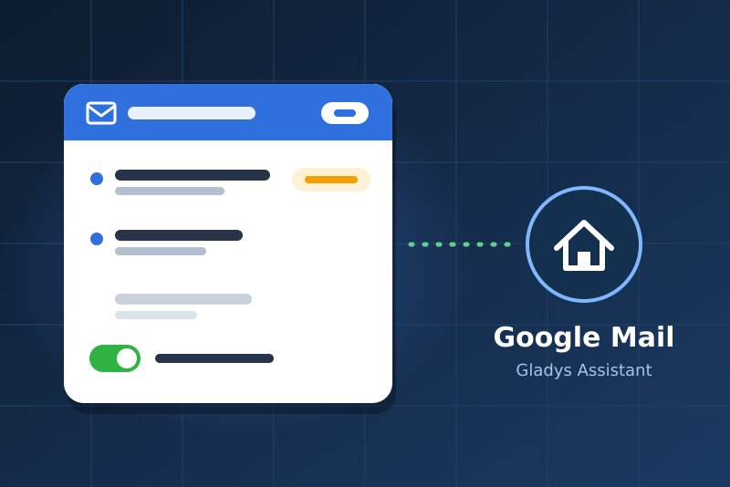
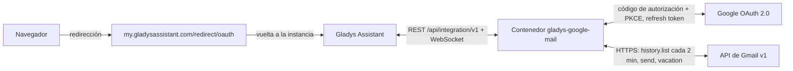
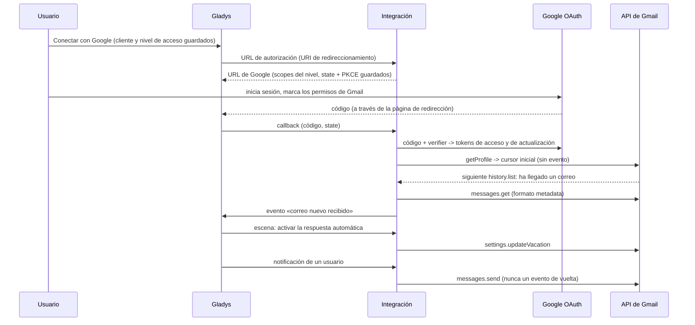
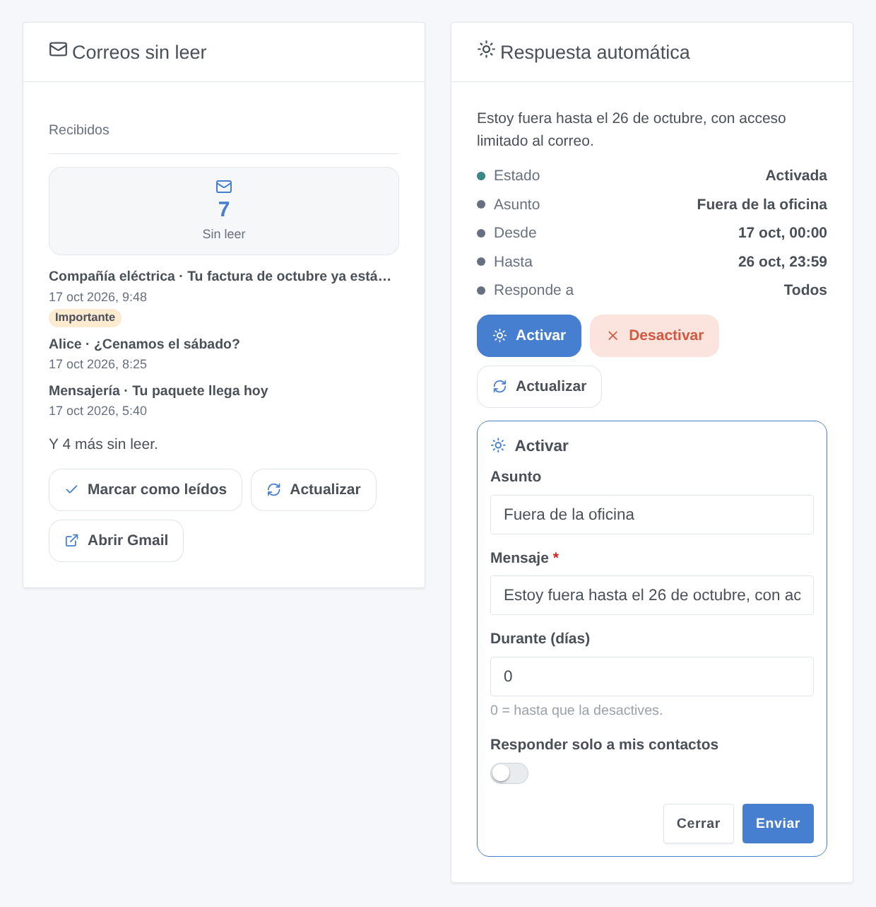

# Gladys Google Mail

[English](README.md) · [Français](README.fr.md) · [Deutsch](README.de.md) · **Español**

[](LICENSE)
[](https://github.com/William-De71/gladys-google-mail/releases)
[](https://github.com/William-De71/gladys-google-mail/actions/workflows/release.yml)
[](https://gladysassistant.com)



Integración externa de [Gladys Assistant](https://gladysassistant.com) para **Gmail**: las notificaciones de Gladys salen por correo, la respuesta automática se controla desde las escenas y el panel, y cada correo nuevo puede lanzar una escena. Usa la API oficial de Gmail con tu propio cliente OAuth de Google Cloud, sin contraseña de aplicación.

Documentación de usuario: [English](docs/en.md) · [Français](docs/fr.md) · [Deutsch](docs/de.md) · [Español](docs/es.md).

> Integración de la comunidad, sin relación con Google ni respaldada por Google. **Nunca probada con una cuenta de Google real**: se agradecen los comentarios.

## Funciones

- **Notificaciones por correo** (canal de comunicación «solo envío»): cada usuario elige la dirección que las recibe; la imagen de una notificación se adjunta.
- **1 activador de escena**, **5 acciones de escena** y **2 widgets**, con un formulario «Activar la respuesta automática» (más abajo).
- **Tres niveles de acceso** con los permisos de Gmail más estrictos para cada uno: solo envío y respuesta automática (`gmail.send`, `gmail.settings.basic`), + leer los encabezados (`gmail.metadata`), o + leer y organizar (`gmail.modify`). El cuerpo de los correos nunca se lee.
- **OAuth 2.0** con tu propio cliente de Google Cloud: PKCE, state guardado en `/data` tras un reinicio, tokens renovados, un acceso revocado se indica sin saturar a Google.
- **Lectura del historial de Gmail** cada 2 minutos por defecto (`users.history.list`, 2 unidades de cuota), reanudada tras un reinicio.
- Cuatro idiomas en todas partes: inglés, francés, alemán, español.

**Frente a las integraciones de la tienda**: [SMTP](https://github.com/GladysAssistant/gladys-smtp) envía las notificaciones por cualquier servidor (contraseña de aplicación para Gmail), sin escenas ni widgets; [IMAP Mail](https://github.com/guim31/gladys-imap) lee buzones IMAP con una contraseña de aplicación. Google Mail es específica de Gmail: OAuth sin contraseña de aplicación, permisos mínimos, respuesta automática, etiquetas y categorías de Gmail, envío + lectura + organización en una sola integración.

## Funcionamiento






### Transporte

`transports: ["cloud"]`: todo pasa por los servidores de Google; tus datos solo circulan entre Google y tu Gladys. Una integración de comunicación no tiene dispositivos, por lo que no hay insignia por dispositivo: el estado de conexión de la página de la integración indica si Google responde.

## Dispositivos y funciones

Ningún dispositivo: el tipo `communication` solo muestra la pantalla de configuración. El número de correos sin leer está en el widget, en el estado de conexión y en la acción «leer los correos sin leer».

| Capacidad                           | Permiso de Gmail                  | Dónde                              |
| ----------------------------------- | --------------------------------- | ---------------------------------- |
| Notificaciones por correo           | `gmail.send`                      | Canal de comunicación (Mi cuenta)  |
| Respuesta automática                | `gmail.settings.basic`            | Acciones de escena, widget         |
| Correo nuevo, sin leer              | `gmail.metadata` o `gmail.modify` | Activador, acción, widget          |
| Extracto, leído, etiqueta, archivar | `gmail.modify`                    | Variable, acción, botón del widget |

## Activadores, acciones de escena y widgets



- Activador: **correo nuevo recibido**, filtrable por dirección del remitente, etiqueta de Gmail y categoría; remitente, asunto, extracto, etiquetas e ID como variables.
- Acciones: **enviar un correo** (Para, Cc, Cco, asunto, texto o HTML sencillo), **activar la respuesta automática** (asunto, mensaje, fechas opcionales en la zona horaria de Gladys, solo contactos), **desactivarla**, **leer los correos sin leer**, **marcar leído / etiquetar / archivar**. Nunca activan una escena de vuelta.
- Widgets: **Correos sin leer** (bandeja de entrada o etiqueta, los cinco más recientes, Marcar como leídos / Actualizar / Abrir Gmail) y **Respuesta automática** (estado, fechas, Activar / Desactivar).
- Ejemplos: cuando llega una factura de un remitente concreto, avisar y añadirle una etiqueta; cuando la casa pasa a modo vacaciones, activar la respuesta automática durante 14 días; cuando salta la alarma, enviar un correo a la familia.

No implementado: borradores, adjuntos desde una escena, eliminación, recepción de mensajes por correo (un correo no controla la casa), notificaciones push de Gmail (Pub/Sub, fuera del alcance de un servidor doméstico).

## Requisitos

- Gladys **5.2.0** o posterior (las versiones anteriores no pueden instalar la integración: formularios de los widgets, widgets y escenas).
- Una cuenta de Gmail.
- Un proyecto gratuito de Google Cloud con la API de Gmail habilitada, una pantalla de consentimiento **En producción** y un cliente OAuth de tipo **Aplicación web** cuyo URI de redireccionamiento sea `https://my.gladysassistant.com/redirect/oauth` (paso a paso en la [documentación](docs/es.md#configuración)).

## Instalación

- **Desde la tienda**: Integraciones → Google Mail → Instalar.
- **Desde la URL del repositorio**: Integraciones → Añadir una integración externa → `https://github.com/William-De71/gladys-google-mail`.
- **Modo desarrollador**: `npm install` y luego ejecútala junto a un Gladys en modo desarrollador con las variables de abajo.

## Configuración

| Campo                                | Por defecto | Función                                                 |
| ------------------------------------ | ----------- | ------------------------------------------------------- |
| Client ID                            | —           | Tu cliente OAuth (`….apps.googleusercontent.com`)       |
| Client secret                        | —           | Su secreto (`GOCSPX-…`)                                 |
| Qué puede hacer Gladys               | Lectura     | Nivel de acceso, es decir, los permisos pedidos         |
| Conectar con Google                  | —           | Conexión OAuth 2.0                                      |
| Buscar correos nuevos cada (minutos) | 2           | 1 a 60; 3 unidades de cuota + 20 por correo nuevo       |
| Asunto de las notificaciones         | Gladys      | Asunto de los correos de notificación                   |
| Mi cuenta → Dirección de correo      | —           | Por usuario: la dirección que recibe sus notificaciones |

Acciones de configuración: **Probar la conexión** (cuenta, permisos, cuota del día), **Diagnóstico** (resumen anonimizado en los registros), **Desconectar de Google** (revoca el acceso en Google).

## Uso

Guarda el Client ID, el secreto y el nivel de acceso, pulsa **Conectar con Google**, acepta el aviso «aplicación no verificada» (es la tuya) y marca los permisos de Gmail. Cada usuario introduce luego su dirección en **Mi cuenta**; añade los widgets a un panel y crea tus escenas.

## Desarrollo

```bash
npm install
npm test                     # node --test, nunca toca la red
npm run lint && npm run format:check
npx github:GladysAssistant/integration-store . --skip-image-check
docs/illustrations/render.sh # ilustraciones de los widgets
scripts/build-cover.sh       # cover.jpg
```

Variables de entorno (proporcionadas por el supervisor de Gladys): `GLADYS_HOST_API_URL`, `GLADYS_INTEGRATION_TOKEN`, `GLADYS_INTEGRATION_SELECTOR` y `TZ` (la zona horaria de Gladys, para las fechas de la respuesta automática). `GLADYS_DATA_DIR` cambia la carpeta de datos (`/data` por defecto) durante el desarrollo.

## Proceso de publicación


Cada fusión en `main` lanza la CI y luego calcula la versión a partir de los [Conventional Commits](https://www.conventionalcommits.org/) desde la última etiqueta: `feat` → menor, `fix` / `perf` → parche, `!` o `BREAKING CHANGE` → mayor (una menor mientras < 1.0.0); `docs`, `chore`, `ci`, `test`, `style`, `refactor`, `build` solos no publican nada. Sin etiqueta, la 0.1.0 se publica tal cual. Se genera la sección del changelog, se empuja la etiqueta, se construye la imagen multiarquitectura, luego `main` recibe el commit de publicación (la tienda nunca ve una versión sin su imagen), se crea la GitHub Release y un último job comprueba la imagen pública, el validador de la tienda y el topic.

- El título de la pull request se convierte en el commit squash y luego en la línea del changelog: escríbelo en inglés, para el usuario (`pr-title.yml` lo comprueba). Nunca edites `CHANGELOG.md` a mano.
- La 1.0.0 es una decisión: Actions → Release → Run workflow con `release-as: 1.0.0`. `dry-run` muestra la versión y las notas sin publicar nada.
- **Rama protegida**: la publicación empuja su commit a `main` con `GITHUB_TOKEN`. Con un ruleset en `main`, añade GitHub Actions a su lista de omisión (o usa una GitHub App); si no, el job de publicación falla.
- Tras la primera publicación, el paquete `ghcr.io` debe ser público (Package settings → Change visibility).

## Solución de problemas

Consulta [docs/es.md](docs/es.md#solución-de-problemas) (URI de redireccionamiento, aplicación en prueba, permiso sin marcar, API no habilitada, cuenta de Workspace). Informa de un problema con las versiones de Gladys y de la integración, el nivel de acceso elegido y la salida del botón **Diagnóstico** (Ajustes → Supervisión).

## Contribuir

Las issues y pull requests son bienvenidas. Ejecuta `npm run format:check && npm run lint && npm test` antes de abrir una pull request, y no cambies ninguna clave guardada (ver [CLAUDE.md](CLAUDE.md)).

## Seguridad

Consulta [SECURITY.md](SECURITY.md): informa de las vulnerabilidades en privado. El Client secret es un campo `secret`; los tokens y el cursor están en `/data/state.json` (0600) y nunca se escriben en los registros, como tampoco las direcciones, asuntos o extractos de los correos; los encabezados introducidos en una escena se limpian (sin inyección de encabezados).

## Capturas pendientes

Las imágenes de arriba son ilustraciones, no capturas. Las capturas reales irán a `docs/assets/screenshots/` (PNG, 1280 × 800): `configuration.png`, `google-consent.png`, `my-account.png`, `scene-trigger.png`.

## Licencia

[Licencia Apache 2.0](LICENSE) — ver también [NOTICE](NOTICE). Google y Gmail son marcas de Google LLC; esta integración de la comunidad no está afiliada. Gracias a la documentación y al SDK de Gladys.
