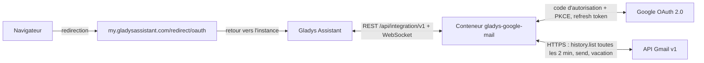
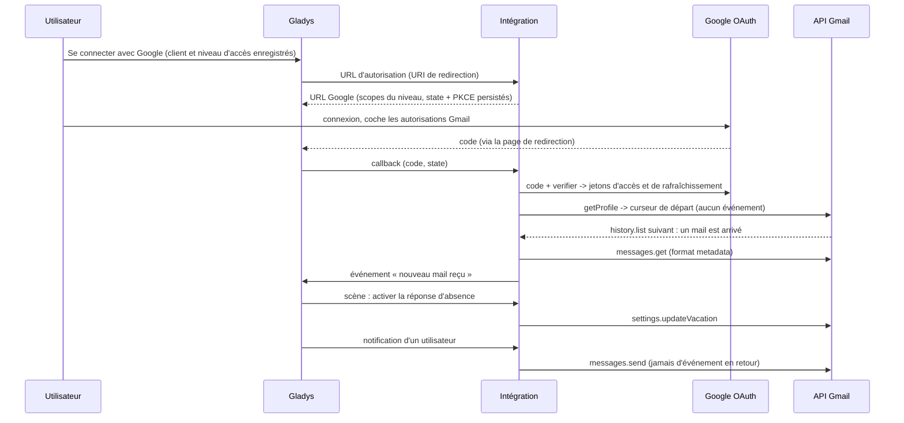
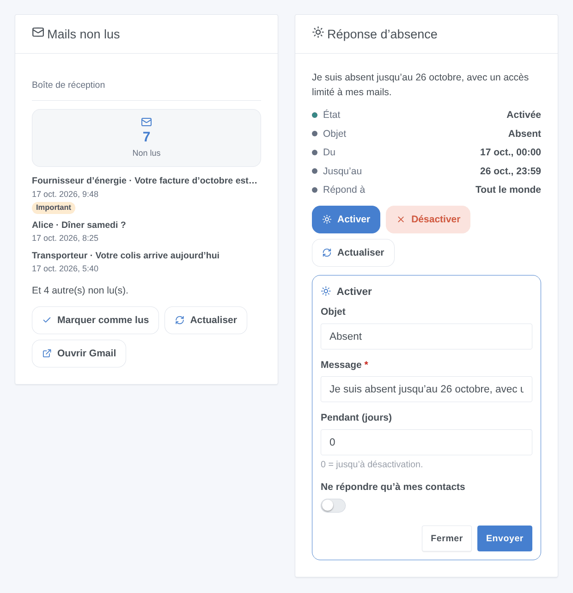

# Gladys Google Mail

[English](README.md) · **Français** · [Deutsch](README.de.md) · [Español](README.es.md)

[](LICENSE)
[](https://github.com/William-De71/gladys-google-mail/releases)
[](https://github.com/William-De71/gladys-google-mail/actions/workflows/release.yml)
[](https://gladysassistant.com)


Intégration externe [Gladys Assistant](https://gladysassistant.com) pour **Gmail** : les notifications de Gladys partent par e-mail, la réponse automatique d’absence se pilote depuis les scènes et le tableau de bord, et chaque nouveau mail peut lancer une scène. Elle passe par l’API Gmail officielle avec votre propre client OAuth Google Cloud, sans mot de passe d’application.

Documentation utilisateur : [English](docs/en.md) · [Français](docs/fr.md) · [Deutsch](docs/de.md) · [Español](docs/es.md).

> Intégration communautaire, sans lien avec Google ni approuvée par Google. **Jamais testée avec un vrai compte Google** : retours bienvenus.

## Fonctionnalités

- **Notifications par e-mail** (canal de communication « envoi seul ») : chaque utilisateur choisit l’adresse qui les reçoit ; l’image d’une notification est jointe.
- **1 déclencheur de scène**, **5 actions de scène** et **2 widgets**, dont un formulaire « Activer la réponse d’absence » (ci-dessous).
- **Trois niveaux d’accès** et les autorisations Gmail les plus étroites pour chacun : envoi et réponse d’absence seulement (`gmail.send`, `gmail.settings.basic`), + lecture des en-têtes (`gmail.metadata`), ou + lecture et organisation (`gmail.modify`). Le corps des mails n’est jamais lu.
- **OAuth 2.0** avec votre propre client Google Cloud : PKCE, state conservé dans `/data` après un redémarrage, jetons renouvelés, accès révoqué signalé sans marteler Google.
- **Lecture de l’historique Gmail** toutes les 2 minutes par défaut (`users.history.list`, 2 unités de quota), reprise après un redémarrage.
- Quatre langues partout : anglais, français, allemand, espagnol.

**Par rapport aux intégrations du store** : [SMTP](https://github.com/GladysAssistant/gladys-smtp) envoie les notifications par n’importe quel serveur (mot de passe d’application pour Gmail), sans scènes ni widgets ; [IMAP Mail](https://github.com/guim31/gladys-imap) lit des boîtes IMAP avec un mot de passe d’application. Google Mail est propre à Gmail : OAuth sans mot de passe d’application, autorisations minimales, réponse d’absence, libellés et catégories Gmail, envoi + lecture + organisation dans une seule intégration.

## Fonctionnement






### Transport

`transports: ["cloud"]` : tout passe par les serveurs de Google ; vos données ne circulent qu’entre Google et votre Gladys. Une intégration de type communication n’a pas d’appareils, donc pas de badge par appareil : l’état de connexion de la page de l’intégration dit si Google répond.

## Appareils et fonctionnalités

Aucun appareil : le type `communication` n’expose que l’écran de configuration. Le nombre de non lus est disponible dans le widget, dans l’état de connexion et dans l’action « lire les mails non lus ».

| Capacité                               | Autorisation Gmail                 | Où                                  |
| -------------------------------------- | ---------------------------------- | ----------------------------------- |
| Notifications par e-mail               | `gmail.send`                       | Canal de communication (Mon compte) |
| Réponse d’absence                      | `gmail.settings.basic`             | Actions de scène, widget            |
| Nouveau mail, non lus                  | `gmail.metadata` ou `gmail.modify` | Déclencheur, action, widget         |
| Extrait, marquer lu, libellé, archiver | `gmail.modify`                     | Variable, action, bouton du widget  |

## Déclencheurs, actions de scène et widgets



- Déclencheur : **nouveau mail reçu**, filtrable par adresse de l’expéditeur, libellé Gmail et catégorie ; variables expéditeur, objet, extrait, libellés, identifiants.
- Actions : **envoyer un mail** (À, Cc, Cci, objet, texte ou HTML simple), **activer la réponse d’absence** (objet, message, dates facultatives dans le fuseau de Gladys, contacts seulement), **la désactiver**, **lire les mails non lus**, **marquer lu / libeller / archiver**. Elles ne déclenchent jamais de scène en retour.
- Widgets : **Mails non lus** (boîte de réception ou libellé, cinq derniers, Marquer comme lus / Actualiser / Ouvrir Gmail) et **Réponse d’absence** (état, dates, Activer / Désactiver).
- Exemples : quand une facture arrive d’un expéditeur donné, notifier et lui appliquer un libellé ; quand la maison passe en mode vacances, activer la réponse d’absence pour 14 jours ; quand l’alarme se déclenche, envoyer un mail à la famille.

Non implémenté : brouillons, pièces jointes depuis une scène, suppression, réception de messages par e-mail (un mail ne pilote pas la maison), notifications push Gmail (Pub/Sub, hors de portée d’un serveur domestique).

## Prérequis

- Gladys **5.2.0** ou plus récent (les versions antérieures ne peuvent pas installer l’intégration : formulaires des widgets, widgets et scènes).
- Un compte Gmail.
- Un projet Google Cloud gratuit avec l’API Gmail activée, un écran de consentement **En production** et un client OAuth de type **Application Web** dont l’URI de redirection est `https://my.gladysassistant.com/redirect/oauth` (pas à pas dans la [documentation](docs/fr.md#configuration)).

## Installation

- **Depuis le store** : Intégrations → Google Mail → Installer.
- **Depuis l’URL du dépôt** : Intégrations → Ajouter une intégration externe → `https://github.com/William-De71/gladys-google-mail`.
- **Mode développeur** : `npm install`, puis lancez-la à côté d’un Gladys en mode développeur avec les variables ci-dessous.

## Configuration

| Champ                                        | Par défaut | Rôle                                                     |
| -------------------------------------------- | ---------- | -------------------------------------------------------- |
| Client ID                                    | —          | Votre client OAuth (`….apps.googleusercontent.com`)      |
| Client secret                                | —          | Son code secret (`GOCSPX-…`)                             |
| Ce que Gladys peut faire                     | Lecture    | Niveau d’accès, donc autorisations demandées             |
| Se connecter avec Google                     | —          | Connexion OAuth 2.0                                      |
| Chercher les nouveaux mails toutes les (min) | 2          | 1 à 60 ; 3 unités de quota + 20 par nouveau mail         |
| Objet des notifications                      | Gladys     | Objet des mails de notification                          |
| Mon compte → Adresse e-mail                  | —          | Par utilisateur : l’adresse qui reçoit ses notifications |

Actions de configuration : **Tester la connexion** (compte, autorisations, quota du jour), **Diagnostic** (résumé anonymisé dans les journaux), **Se déconnecter de Google** (révoque l’accès chez Google).

## Utilisation

Enregistrez le Client ID, le secret et le niveau d’accès, cliquez sur **Se connecter avec Google**, acceptez l’avertissement « application non validée » (c’est la vôtre) et cochez les autorisations Gmail. Chaque utilisateur saisit ensuite son adresse dans **Mon compte**, puis ajoutez les widgets à un tableau de bord et créez vos scènes.

## Développement

```bash
npm install
npm test                     # node --test, ne touche jamais le réseau
npm run lint && npm run format:check
npx github:GladysAssistant/integration-store . --skip-image-check
docs/illustrations/render.sh # illustrations des widgets
scripts/build-cover.sh       # cover.jpg
```

Variables d’environnement (fournies par le superviseur de Gladys) : `GLADYS_HOST_API_URL`, `GLADYS_INTEGRATION_TOKEN`, `GLADYS_INTEGRATION_SELECTOR`, et `TZ` (le fuseau horaire de Gladys, pour les dates de la réponse d’absence). `GLADYS_DATA_DIR` change le dossier des données (`/data` par défaut) en développement.

## Processus de release


Chaque fusion sur `main` lance la CI, puis calcule la version à partir des [Conventional Commits](https://www.conventionalcommits.org/) depuis le dernier tag : `feat` → mineure, `fix` / `perf` → correctif, `!` ou `BREAKING CHANGE` → majeure (une mineure tant que < 1.0.0) ; `docs`, `chore`, `ci`, `test`, `style`, `refactor`, `build` seuls ne publient rien. Sans tag, la 0.1.0 est publiée telle quelle. La section du changelog est générée, le tag poussé, l’image multi-architecture construite, puis `main` reçoit le commit de release (le store ne voit donc jamais une version sans son image), la GitHub Release est créée et un dernier job vérifie l’image publique, le validateur du store et le topic.

- Le titre de la pull request devient le commit squash, puis la ligne du changelog : écrivez-le en anglais, pour l’utilisateur (`pr-title.yml` le vérifie). Ne modifiez jamais `CHANGELOG.md` à la main.
- La 1.0.0 est une décision : Actions → Release → Run workflow avec `release-as: 1.0.0`. `dry-run` affiche la version et les notes sans rien publier.
- **Branche protégée** : la release pousse son commit sur `main` avec `GITHUB_TOKEN`. Avec un ruleset sur `main`, ajoutez GitHub Actions à sa liste de contournement (ou passez par une GitHub App), sinon le job de publication échoue.
- Après la première release, le package `ghcr.io` doit être public (Package settings → Change visibility).

## Dépannage

Voir [docs/fr.md](docs/fr.md#dépannage) (URI de redirection, application restée en test, autorisation non cochée, API non activée, compte Workspace). Signalez un problème avec les versions de Gladys et de l’intégration, le niveau d’accès choisi, et la sortie du bouton **Diagnostic** (Paramètres → Supervision).

## Contribuer

Les issues et pull requests sont les bienvenues. Lancez `npm run format:check && npm run lint && npm test` avant d’ouvrir une pull request, et ne changez aucune clé stockée (voir [CLAUDE.md](CLAUDE.md)).

## Sécurité

Voir [SECURITY.md](SECURITY.md) : signalez les failles en privé. Le Client secret est un champ `secret` ; les jetons et le curseur sont dans `/data/state.json` (droits 0600) et ne sont jamais écrits dans les journaux, pas plus que les adresses, objets ou extraits des mails ; les en-têtes saisis dans une scène sont nettoyés (pas d’injection d’en-tête).

## Captures à venir

Les images ci-dessus sont des illustrations, pas des captures. Les vraies captures iront dans `docs/assets/screenshots/` (PNG, 1280 × 800) : `configuration.png`, `google-consent.png`, `my-account.png`, `scene-trigger.png`.

## Licence

[Licence Apache 2.0](LICENSE) — voir aussi [NOTICE](NOTICE). Google et Gmail sont des marques de Google LLC ; cette intégration communautaire n’y est pas affiliée. Merci à la documentation et au SDK de Gladys.
