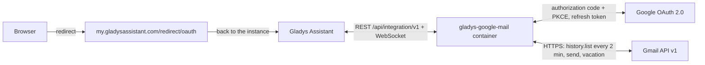
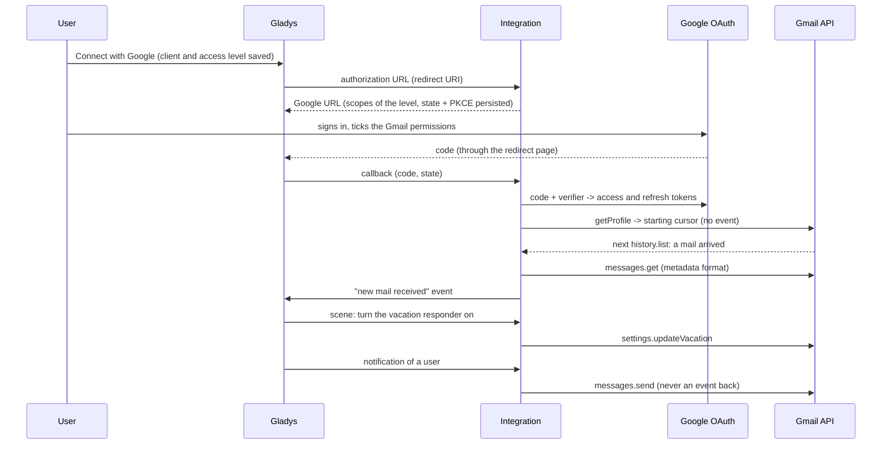
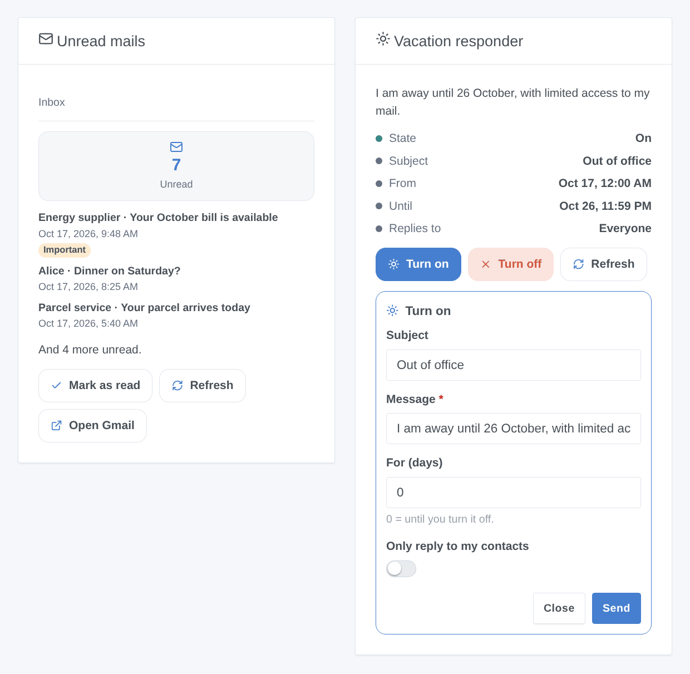

# Gladys Google Mail

**English** · [Français](README.fr.md) · [Deutsch](README.de.md) · [Español](README.es.md)

[](LICENSE)
[](https://github.com/William-De71/gladys-google-mail/releases)
[](https://github.com/William-De71/gladys-google-mail/actions/workflows/release.yml)
[](https://gladysassistant.com)


[Gladys Assistant](https://gladysassistant.com) external integration for **Gmail**: Gladys notifications go out by email, the vacation responder is driven from scenes and the dashboard, and every new mail can start a scene. It uses the official Gmail API with your own Google Cloud OAuth client, without any app password.

User documentation: [English](docs/en.md) · [Français](docs/fr.md) · [Deutsch](docs/de.md) · [Español](docs/es.md).

> Community integration, not affiliated with nor endorsed by Google. **Never tested with a real Google account**: feedback welcome.

## Features

- **Notifications by email** (a "send-only" communication channel): each user picks the address that receives them; the image of a notification is attached.
- **1 scene trigger**, **5 scene actions** and **2 widgets**, including a "Turn the vacation responder on" form (below).
- **Three access levels** with the narrowest Gmail permissions for each: send and vacation responder only (`gmail.send`, `gmail.settings.basic`), + reading the headers (`gmail.metadata`), or + reading and organizing (`gmail.modify`). The body of the mails is never read.
- **OAuth 2.0** with your own Google Cloud client: PKCE, state kept in `/data` across a restart, tokens refreshed, a revoked access reported without hammering Google.
- **Reading of the Gmail history** every 2 minutes by default (`users.history.list`, 2 quota units), resumed after a restart.
- Four languages everywhere: English, French, German, Spanish.

**Compared with the integrations of the store**: [SMTP](https://github.com/GladysAssistant/gladys-smtp) sends notifications through any server (app password for Gmail), without scenes nor widgets; [IMAP Mail](https://github.com/guim31/gladys-imap) reads IMAP mailboxes with an app password. Google Mail is specific to Gmail: OAuth without app password, minimal permissions, vacation responder, Gmail labels and categories, sending + reading + organizing in a single integration.

## How it works






### Transport

`transports: ["cloud"]`: everything goes through the Google servers; your data only travels between Google and your Gladys. A communication integration has no devices, hence no badge per device: the connection status of the integration page tells whether Google answers.

## Devices and features

No device: the `communication` type only exposes the Configuration screen. The unread count is available in the widget, in the connection status and in the "read the unread mails" action.

| Capability                         | Gmail permission                   | Where                              |
| ---------------------------------- | ---------------------------------- | ---------------------------------- |
| Notifications by email             | `gmail.send`                       | Communication channel (My account) |
| Vacation responder                 | `gmail.settings.basic`             | Scene actions, widget              |
| New mail, unread mails             | `gmail.metadata` or `gmail.modify` | Trigger, action, widget            |
| Snippet, mark read, label, archive | `gmail.modify`                     | Variable, action, widget button    |

## Scene triggers, actions and widgets



- Trigger: **new mail received**, filtered by sender address, Gmail label and category; sender, subject, snippet, labels and IDs as variables.
- Actions: **send a mail** (to, cc, bcc, subject, plain text or simple HTML), **turn the vacation responder on** (subject, message, optional dates in the time zone of Gladys, contacts only), **turn it off**, **read the unread mails**, **mark read / label / archive**. They never fire a scene back.
- Widgets: **Unread mails** (inbox or label, five newest, Mark as read / Refresh / Open Gmail) and **Vacation responder** (state, dates, Turn on / Turn off).
- Examples: when a bill arrives from a given sender, notify and add a label to it; when the house switches to vacation mode, turn the vacation responder on for 14 days; when the alarm goes off, send a mail to the family.

Not implemented: drafts, attachments from a scene, deletion, receiving messages by email (a mail does not control the house), Gmail push notifications (Pub/Sub, out of reach of a home server).

## Requirements

- Gladys **5.2.0** or later (older releases cannot install the integration: widget forms, widgets and scenes).
- A Gmail account.
- A free Google Cloud project with the Gmail API enabled, a consent screen **In production** and an OAuth client of type **Web application** whose redirect URI is `https://my.gladysassistant.com/redirect/oauth` (step by step in the [documentation](docs/en.md#configuration)).

## Installation

- **From the store**: Integrations → Google Mail → Install.
- **From the repository URL**: Integrations → Add an external integration → `https://github.com/William-De71/gladys-google-mail`.
- **Developer mode**: `npm install`, then run it next to a Gladys in developer mode with the variables below.

## Configuration

| Field                              | Default | Role                                                    |
| ---------------------------------- | ------- | ------------------------------------------------------- |
| Client ID                          | —       | Your OAuth client (`….apps.googleusercontent.com`)      |
| Client secret                      | —       | Its secret (`GOCSPX-…`)                                 |
| What Gladys may do                 | Reading | Access level, hence the permissions asked               |
| Connect with Google                | —       | OAuth 2.0 connection                                    |
| Look for new mails every (minutes) | 2       | 1 to 60; 3 quota units + 20 per new mail                |
| Subject of the notifications       | Gladys  | Subject of the notification mails                       |
| My account → Email address         | —       | Per user: the address that receives their notifications |

Configuration actions: **Test the connection** (account, permissions, quota of the day), **Diagnostic** (an anonymized summary in the logs), **Disconnect from Google** (revokes the access at Google).

## Usage

Save the Client ID, the secret and the access level, click **Connect with Google**, accept the "unverified app" warning (it is yours) and tick the Gmail permissions. Each user then enters their address in **My account**; add the widgets to a dashboard and create your scenes.

## Development

```bash
npm install
npm test                     # node --test, never touches the network
npm run lint && npm run format:check
npx github:GladysAssistant/integration-store . --skip-image-check
docs/illustrations/render.sh # widget illustrations
scripts/build-cover.sh       # cover.jpg
```

Environment variables (provided by the Gladys supervisor): `GLADYS_HOST_API_URL`, `GLADYS_INTEGRATION_TOKEN`, `GLADYS_INTEGRATION_SELECTOR`, and `TZ` (the time zone of Gladys, for the dates of the vacation responder). `GLADYS_DATA_DIR` changes the data directory (`/data` by default) during development.

## Release process


Every merge into `main` runs the CI, then computes the version from the [Conventional Commits](https://www.conventionalcommits.org/) since the last tag: `feat` → minor, `fix` / `perf` → patch, `!` or `BREAKING CHANGE` → major (a minor while < 1.0.0); `docs`, `chore`, `ci`, `test`, `style`, `refactor`, `build` alone publish nothing. Without a tag, 0.1.0 is published as is. The changelog section is generated, the tag pushed, the multi-arch image built, then `main` gets the release commit (so the store never sees a version without its image), the GitHub Release is created and a last job checks the public image, the store validator and the topic.

- The pull request title becomes the squash commit, then the changelog line: write it in English, for the user (`pr-title.yml` checks it). Never edit `CHANGELOG.md` by hand.
- 1.0.0 is a decision: Actions → Release → Run workflow with `release-as: 1.0.0`. `dry-run` shows the version and the notes without publishing anything.
- **Protected branch**: the release pushes its commit to `main` with `GITHUB_TOKEN`. With a ruleset on `main`, add GitHub Actions to its bypass list (or use a GitHub App), otherwise the publish job fails.
- After the first release, the `ghcr.io` package must be public (Package settings → Change visibility).

## Troubleshooting

See [docs/en.md](docs/en.md#troubleshooting) (redirect URI, app left in testing, unticked permission, API not enabled, Workspace account). Report a problem with the Gladys and integration versions, the chosen access level, and the output of the **Diagnostic** button (Settings → Supervision).

## Contributing

Issues and pull requests are welcome. Run `npm run format:check && npm run lint && npm test` before opening a pull request, and never change a stored key (see [CLAUDE.md](CLAUDE.md)).

## Security

See [SECURITY.md](SECURITY.md): report vulnerabilities privately. The Client secret is a `secret` field; the tokens and the cursor live in `/data/state.json` (0600) and are never written to the logs, nor are the addresses, subjects or snippets of the mails; the headers typed in a scene are cleaned (no header injection).

## Screenshots to come

The images above are illustrations, not screenshots. The real screenshots will go to `docs/assets/screenshots/` (PNG, 1280 × 800): `configuration.png`, `google-consent.png`, `my-account.png`, `scene-trigger.png`.

## License

[Apache License 2.0](LICENSE) — see also [NOTICE](NOTICE). Google and Gmail are trademarks of Google LLC; this community integration is not affiliated with it. Thanks to the documentation and SDK of Gladys.
